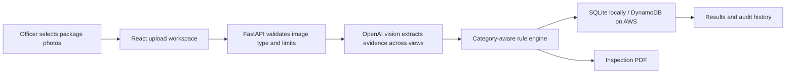

# Nyay Vision

**Metrology Guard AI - packaging label review for Indian market surveillance.**

Nyay Vision helps an officer review packaged-product declarations from package photos. It uses OpenAI vision models to extract visible label information, identifies a likely product category, applies category-aware screening rules, and creates a structured inspection report.

Upload one photo or several views of **the same product**. The multi-image flow combines the views into one extraction, one compliance assessment, and one report. A model match check prevents uncertain or unrelated product photos from being merged.

> **Operational aid only.** Nyay Vision does not make a legal determination, calculate a payable fine, or issue an official notice or challan. An officer must verify the product, complete package, applicable rules, evidence, jurisdiction, and prior-offence history.

## Contents

- [Capabilities](#capabilities)
- [How it works](#how-it-works)
- [Technology](#technology)
- [Repository layout](#repository-layout)
- [Run locally](#run-locally)
- [Configuration](#configuration)
- [Use the application](#use-the-application)
- [HTTP API](#http-api)
- [Deployment](#deployment)
- [Data and security](#data-and-security)
- [Legal and operational limits](#legal-and-operational-limits)
- [Troubleshooting](#troubleshooting)

## Capabilities

- **Single and multi-view audits:** Submit PNG, JPEG/JPG, or WEBP images. A product audit accepts up to 10 views, with a 12 MB per-image limit and a 48 MB combined limit.
- **Product-aware checks:** OpenAI vision classifies the visible product. The backend selects the applicable screening checklist; for example, food-specific checks are not applied to general non-food products.
- **Cross-view evidence:** The extractor can find declarations on different package panels, retain per-image source references for text boxes, and flag conflicting values for review.
- **Structured findings:** Each check is reported as detected, missing, review, or not applicable, with a reference and explanation.
- **Conditional penalty schedule:** Statutory stages or caps are shown as conditional guidance. The system does not add separate statutory amounts or infer an offence stage from a photo.
- **Inspection PDF:** Create a printable officer-oriented report with the image set, extracted details, declaration checklist, conditional penalty schedule, and decision path.
- **Audit history:** Store and retrieve past scans from SQLite locally or DynamoDB on AWS.
- **Offline queue:** When the browser is offline, selected images are saved in IndexedDB and later synchronized as their original single-image or multi-image group.
- **OpenAI model fallback:** Use the configured primary model and optional fallback model list for vision extraction.

## How it works



The model extracts visible text and classification evidence. The backend rule engine decides which checks apply and calculates the screening score. If the uploaded views cannot be confidently matched to one product, the request is rejected so different products are not silently combined.

## Technology

| Area | Technology |
| --- | --- |
| Frontend | React 18, Vite, lucide-react |
| Backend | Python, FastAPI, Uvicorn |
| Vision extraction | OpenAI Responses API with structured JSON output |
| Persistence | SQLite locally; DynamoDB on AWS |
| PDF reports | ReportLab |
| Frontend hosting configuration | Vercel |

## Repository layout

```text
.
├── backend/
│   ├── main.py           # FastAPI routes and scan orchestration
│   ├── extraction.py     # OpenAI image extraction and model fallback
│   ├── rule_engine.py    # Category-aware compliance screening
│   ├── date_engine.py    # Date normalization helpers
│   ├── database.py       # SQLite scan history
│   ├── pdf_generator.py  # Inspection report generation
│   ├── settings.py       # Backend configuration
│   └── requirements.txt
├── aws/
│   ├── app-runner-backend.yaml  # App Runner, DynamoDB, and IAM resources
│   └── deploy-backend.sh        # Build, push, and deploy backend image
├── frontend/
│   ├── src/
│   │   ├── components/   # Upload, results, history, navigation
│   │   ├── lib/          # API client and offline queue
│   │   ├── App.jsx
│   │   └── styles.css
│   ├── .env.example
│   └── package.json
└── vercel.json           # Vercel frontend build configuration
```

## Run locally

### Prerequisites

- Python 3.10 or newer
- Node.js 18 or newer and npm
- An OpenAI API key with access to the configured vision models

### 1. Configure and start the backend

From the repository root:

```bash
cd backend
python -m venv .venv
source .venv/bin/activate
# Windows PowerShell: .venv\Scripts\Activate.ps1
pip install -r requirements.txt
cp .env.example .env
```

Add your key to `backend/.env`:

```dotenv
OPENAI_API_KEY=your_openai_api_key
OPENAI_MODEL=gpt-4.1-mini
OPENAI_FALLBACK_MODELS=gpt-4.1
```

Start the API from the `backend/` directory:

```bash
uvicorn main:app --reload --port 8000
```

The API health endpoint is [http://localhost:8000/health](http://localhost:8000/health), and interactive API documentation is available at [http://localhost:8000/docs](http://localhost:8000/docs).

### 2. Configure and start the frontend

In a second terminal, from the repository root:

```bash
cd frontend
npm ci
cp .env.example .env
npm run dev
```

Open [http://localhost:5173](http://localhost:5173). The local frontend setting points to `http://localhost:8000` by default.

### Production frontend build

```bash
cd frontend
npm ci
npm run build
```

Vite writes the production site to `frontend/dist/`.

## Configuration

### Backend environment

Create `backend/.env` for local use. Keep the OpenAI key on the backend; do not put it in a frontend `VITE_` variable.

| Variable | Default | Purpose |
| --- | --- | --- |
| `OPENAI_API_KEY` | empty | Server-side key used for vision extraction. Required to scan. |
| `OPENAI_MODEL` | `gpt-4.1-mini` | Primary model. |
| `OPENAI_FALLBACK_MODELS` | `gpt-4.1` | Comma-separated fallback model IDs. |
| `DATABASE_PATH` | `data/nyay_vision.db` | SQLite database path, relative to `backend/`. |
| `DYNAMODB_TABLE` | empty | Set on AWS to use DynamoDB instead of local SQLite. |
| `AWS_DEFAULT_REGION` | SDK default | AWS region for DynamoDB. Set by the App Runner template. |
| `CORS_ALLOW_ORIGINS` | empty | Optional comma-separated frontend origins, including scheme, for custom domains. |

The backend also allows local Vite origins and Vercel `*.vercel.app` origins.

### Frontend environment

| Variable | Local value | Purpose |
| --- | --- | --- |
| `VITE_API_URL` | `http://localhost:8000` | Public base URL of the FastAPI backend. Set at frontend build time. |

Use a backend URL with no trailing slash. A browser visiting a Vercel site cannot use `localhost` to reach a backend running on the developer's computer.

## Use the application

1. Open **Packaging audit** and choose one or more supported photos of the same product.
2. Include clear views of different package panels; keep text legible and avoid glare.
3. Run the audit. The app submits the selected views together and creates one result.
4. Review the inferred category and each detected, missing, or uncertain declaration against the full physical package.
5. Follow the officer decision path, verify the applicable law and prior-offence history, then record the authorized action.
6. Download the inspection report or reopen the result from Audit history.

The model reports only what it can read in the supplied views. A declaration not found in a photo may be printed on another side or insert.

## HTTP API

All image uploads use `multipart/form-data`.

| Method | Route | Description |
| --- | --- | --- |
| `GET` | `/health` | Service status and whether the OpenAI key is configured. |
| `POST` | `/scan` | Audit one image. Form field: `file`. |
| `POST` | `/scan-multi` | Audit several views of one product together. Repeat form field: `files`. |
| `GET` | `/history?limit=100` | List recent scan records. Maximum limit: 500. |
| `GET` | `/scan/{scan_id}` | Retrieve a saved scan and its findings. |
| `GET` | `/report/{scan_id}` | Download the generated PDF report. |

Both scan routes return a single scan record containing the category, extraction, audit, image count, and source filenames. `/scan-multi` accepts up to 10 images; all views must represent one product. Supported formats are PNG, JPEG/JPG, and WEBP. The service limits each image to 12 MB and the whole request to 48 MB.

Example multi-image request:

```bash
curl -X POST http://localhost:8000/scan-multi \
  -F 'files=@front.jpg' \
  -F 'files=@back.jpg'
```

FastAPI's interactive request interface is available at `/docs` while the backend is running.

## Deployment

The repository's Vercel configuration builds and serves the frontend. The `aws/` folder deploys the FastAPI backend to AWS App Runner, stores durable scan history in DynamoDB, and reads the OpenAI key from AWS Secrets Manager. App Runner provides the API's HTTPS URL. Its container filesystem is temporary, so reports are generated on demand and scan records live in DynamoDB.

### Deploy the backend to AWS

Prerequisites: an AWS account with permissions to create ECR, App Runner, DynamoDB, IAM, and CloudFormation resources; AWS CLI configured for that account; Docker; and an OpenAI API key. AWS usage can incur charges.

1. In AWS Secrets Manager, create a secret and store the OpenAI key as its `SecretString`. Copy the full secret ARN. Do not put the secret value in a command, repository, or frontend setting.
2. From the repository root, set the deployment inputs and run:

   ```bash
   export AWS_REGION=ap-south-1
   export OPENAI_SECRET_ARN='arn:aws:secretsmanager:ap-south-1:123456789012:secret:nyay/openai-key-AbCdEf'
   export FRONTEND_ORIGIN='https://your-project.vercel.app'
   ./aws/deploy-backend.sh
   ```

   Choose the AWS region for the service and table. `FRONTEND_ORIGIN` is optional for `*.vercel.app` deployments; set it to the exact origin when using a custom domain. The script builds the backend image, pushes it to ECR, creates or updates the CloudFormation stack, then prints the API URL. The stack retains scan history if deleted and enables point-in-time recovery.
3. In Vercel project settings, set `VITE_API_URL` to the printed API URL with no trailing slash, then redeploy the frontend.
4. Open `<API_URL>/health` and confirm `status` is `ok`, `openai_configured` is `true`, and `persistence` is `dynamodb`. Submit a small package image through the Vercel site.

To deploy an updated backend, rerun the script. Each build gets a distinct image tag and updates the App Runner service. For local development, leave `DYNAMODB_TABLE` empty and SQLite remains in use. The frontend-only Vercel deployment does not host the FastAPI service or its database.

## Data and security

- Keep `OPENAI_API_KEY` in the backend environment only. Never commit `.env` files or expose the key in frontend code.
- Image bytes are sent from the backend to the configured OpenAI model for extraction. Use only images you are authorized to process.
- Offline uploads are held in the user's browser IndexedDB until the backend is reachable and the group can sync.
- The backend database contains scan metadata and extracted results. Apply access control, backups, retention, and persistent storage appropriate to your deployment.
- Restrict custom CORS origins to the frontend domains you control.

## Legal and operational limits

Nyay Vision is an AI-assisted first-pass review tool, not a substitute for statutory inspection, legal advice, or an adjudication. Image analysis cannot establish the full product category, pack scope, exemptions, legibility, quantity tolerance, prior offences, jurisdiction, or all current rule requirements. Officers must independently verify the physical product and applicable law.

Penalty information is displayed as conditional statutory stages or caps, not a predicted or payable fine. The application does not infer prior-offence stage from the image and does not add separate statutory routes together. Do not use its score or report as a legal finding without officer review.

Rule references should be checked against current official publications, including the Department of Consumer Affairs' [Legal Metrology Act and rules](https://consumeraffairs.gov.in/pages/legal-metrology-act), the [Jan Vishwas (Amendment of Provisions) Act, 2026](https://consumeraffairs.gov.in/public/upload/files/2026.4.8%20Jan%20Vishwas%20Act%202026_1777014384.pdf), FSSAI's [Labelling and Display Regulations](https://www.fssai.gov.in/upload/uploadfiles/files/Comp_Labelling%20Display_Version%20VIII_09_09_2025.pdf), and the CDSCO [Cosmetics Rules, 2020](https://cdsco.gov.in/opencms/resources/UploadCDSCOWeb/2022/cos_rules/Cosmetics%20Rules%202020.pdf). Rules and amendments can change; this list is not exhaustive.

## Troubleshooting

| Symptom | What to check |
| --- | --- |
| **Backend unavailable** | Start Uvicorn locally or check that `VITE_API_URL` points to the deployed backend. |
| **OpenAI key required** | Set `OPENAI_API_KEY` in the backend environment and restart the backend. |
| **CORS or network error on Vercel** | Confirm `VITE_API_URL`, redeploy the frontend, and add a custom frontend domain to `CORS_ALLOW_ORIGINS` on the backend. |
| **Unsupported image** | Use PNG, JPG/JPEG, or WEBP. HEIC and other formats are not currently accepted. |
| **Image exceeds limit** | Keep each image below 12 MB and the combined upload below 48 MB. |
| **Images could not be matched** | Upload views of one product together; submit different products as separate audits. |
| **OpenAI extraction failed** | Check model access, key permissions, backend logs, and configured primary/fallback model IDs. |
